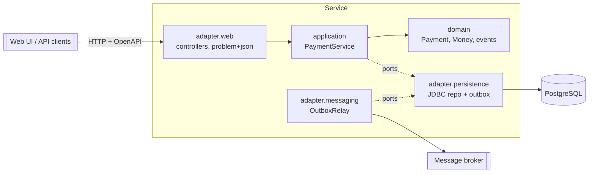

# Architecture

Hexagonal ("ports and adapters"). Dependencies point inwards; `ArchitectureTest` fails the build otherwise.

## Key flows

**Authorise** — `POST /v1/payments` with `Idempotency-Key`. In one DB transaction: insert the payment
(`ON CONFLICT (idempotency_key) DO NOTHING`) and append `payment.authorised` to the outbox. If the insert was a no-op,
the existing payment is loaded: same request → `200` replay, different request → `409`.

**Capture / cancel** — load, apply the state transition in the domain (`AUTHORISED` is the only source state),
write with optimistic locking (`WHERE version = :expected`), append the event. Concurrent writers get `409`.

**Event delivery** — `OutboxRelay` polls unpublished rows (`FOR UPDATE SKIP LOCKED`), publishes via `EventPublisher`,
marks them published. At-least-once: consumers de-duplicate on the event id. See ADR 0003.

## State machine

`AUTHORISED → CAPTURED` · `AUTHORISED → CANCELLED` · both end states are terminal.

## Observability

* Logs: `prod` profile emits ECS JSON, every line carries `traceId`/`spanId`.
* Metrics: JVM/HTTP/JDBC defaults plus `payments.transitions{to}` and `@Observed` timers (`payments.authorise`, ...).
* Traces: OpenTelemetry bridge → OTLP (`OTLP_TRACING_ENDPOINT`), sampling via `TRACING_SAMPLING_PROBABILITY`.
* Probes: `/actuator/health/liveness` and `/readiness`.

## Security & governance notes

* No secrets in the repo: DB credentials come from env vars; defaults are for local only.
* Errors never leak internals (`ApiExceptionHandler`); logs must not contain PII or card data — this sample stores none.
* Add authN/Z (e.g. Spring Security resource server) before exposing beyond a trusted network: see TODOs in the runbook.
* Money is `Long` minor units + ISO 4217 code — never floating point.
* Every state change has an immutable event, which gives an audit trail for regulated contexts.
